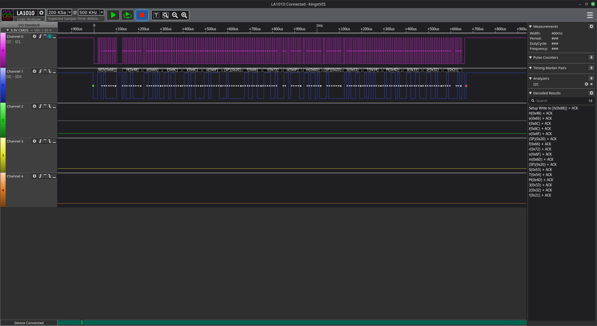
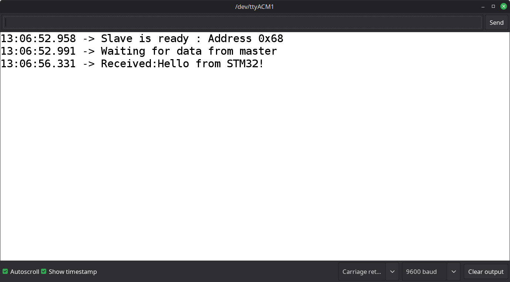
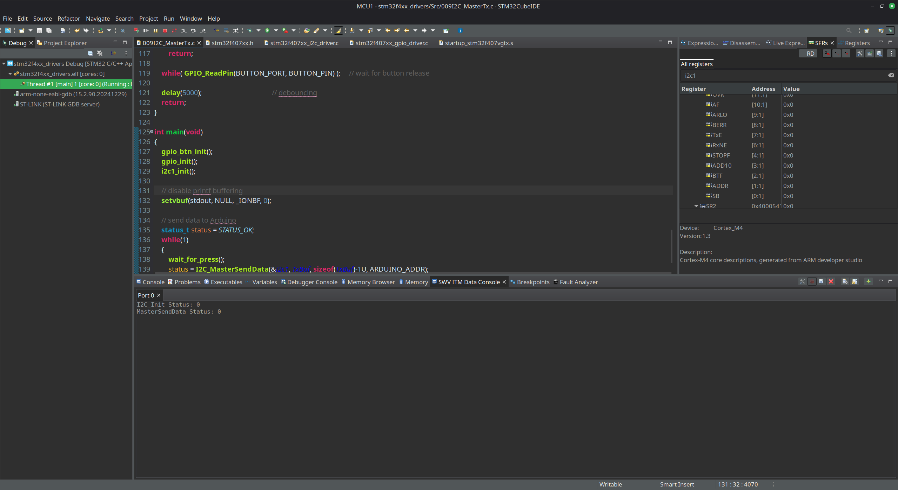
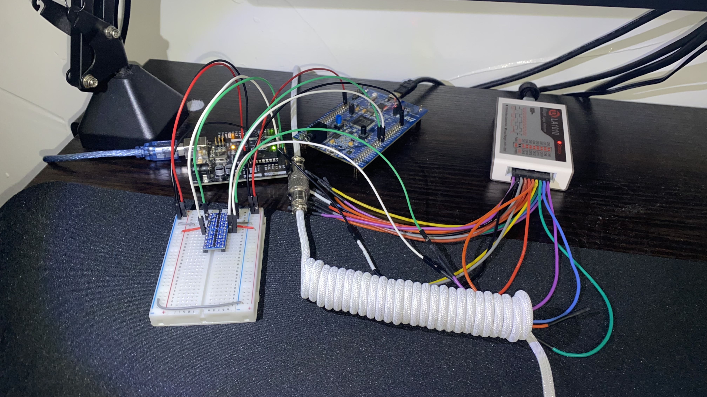

# 009 I2C Master Transmit

### Overview
This demo uses the custom I2C drivers on an STM32F407 Discovery board to transmit data to an Arduino Uno configured as an I2C slave.

The STM32 controller first configures all necessary GPIO pins, the on-board button, as well as the I2C1 peripheral. Then, in an infinite loop, the master waits for the button to be pressed, and then sends `"Hello from STM32!"` using the I2C protocol and bus.

The Arduino slave uses the `<Wire.h>` library to read and print the message to the serial terminal.

## Files
- **STM32 Master File**: `Src/009I2C_MasterTx.c`
- **Arduino Slave File**: `arduino/009_I2C_SlaveRxString/009_I2C_SlaveRxString.ino`

## Wiring
The hardware required to replicate this demo includes:
- Arduino Uno Board
- STM32F407G Discovery Board
- Breadboard
- 3.3V/5V Bi-directional, I2C-compatible Level Shifter
- Jumper Wires
- Pull-up Resistors
- Logic Analyzer (*optional*)

1. Connect the level-shifter to 3.3V (*from the STM32 board*) and 5V (*from the Arduino*), and a common ground (*from the Arduino **and** STM32 board*). Note that the **LV** (*low-voltage*) side of the level-shifter should be connected to 3.3V, and the **HV** (*high-voltage*) side should be connected to 5V.
2. `A5 -> PB6`: Connect the **SCL** of the Arduino (Pin A5) to the **SCL** of I2C1 on the STM32 (PB6) through the level shifter.
3. `A4 -> PB7`: Connect the **SDA** of the Arduino (Pin A4) to the **SDA** of I2C1 on the STM32 (PB7) through the level shifter.
4. If the level-shifter does not contain built-in pull-ups, connect external pull-ups to each side of the level-shifter, on both the SCL and SDA lines.
5. (*optional*) Connect the logic analyzer to the breadboard rows to snoop data. Note that this will increase the capacitance of the I2C bus.

## Images

### Logic Analyzer Sample

- *The decoded data can be seen in the bottom-right panel.*

### Arduino Serial Terminal Output

### STM32F407 SWV Output

- *The SWV output can be seen in the bottom-middle panel.*

### Hardware Setup

