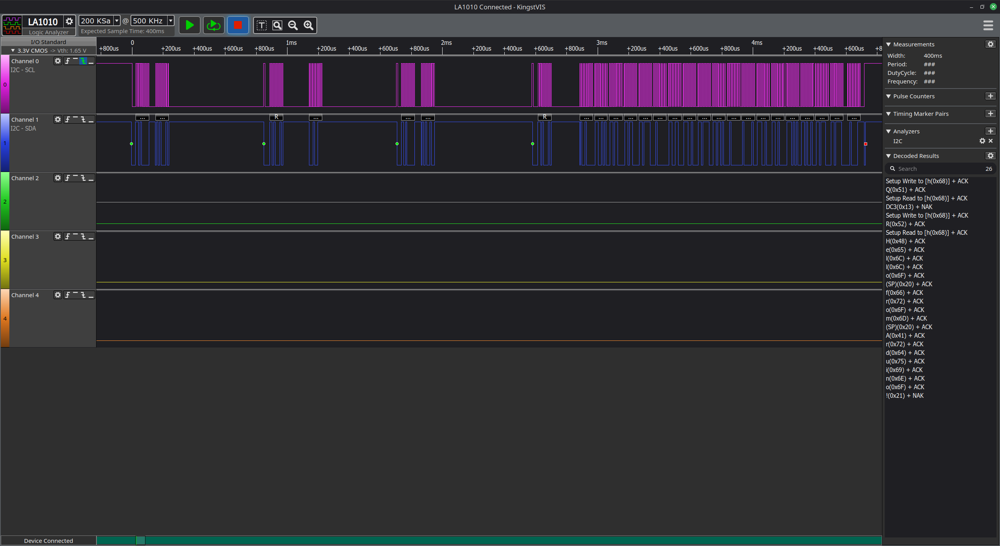
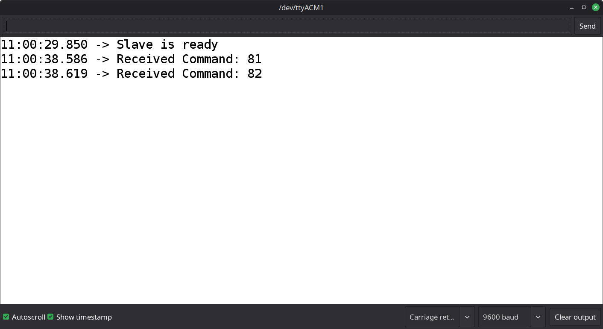
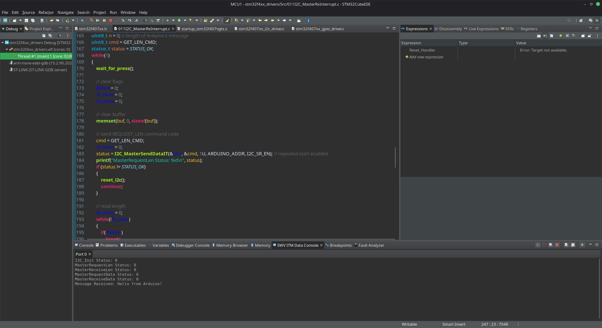
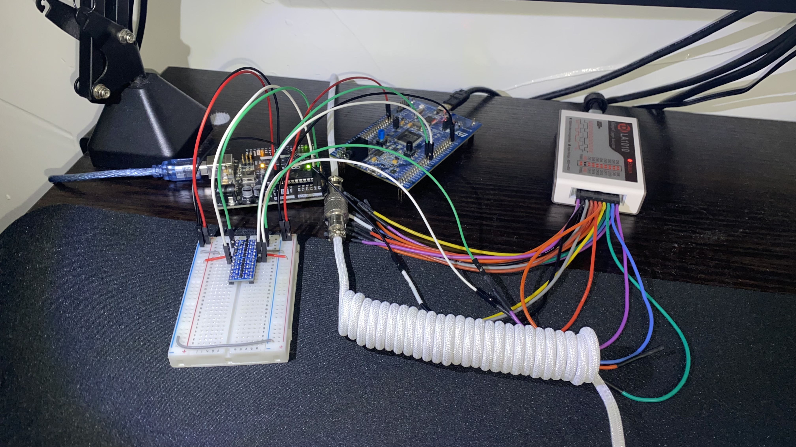

# 011 I2C Master Receive Interrupt

### Overview
This demo uses the custom interrupt-driven I2C drivers on an STM32F407 Discovery board acting as an I2C master to receive length and data information from an Arduino Uno configured as an I2C slave.

The STM32 controller waits for the user-button to be pressed, then performs four transfers (all as an I2C master):
1. Sends a command to the Arduino to request the length of the message in bytes.
2. Issues a repeated START to read the length information from the Arduino.
3. Sends another command using a repeated START to request the message itself from the Arduino.
4. Issues a final repeated START to receive the message. The Arduino transmits the message to the STM32. The STM32 NACKs the last byte of the message and issues a stop-condition, which frees the bus.

This application waits for the previous transfer to finish before issuing the next one using global flags updated by the I2C interrupt callback. Note that this would be unnecessary for blocking transfer APIs, since the application doesn't make progress until the transfer call returns.

If a transfer fails, the callback asserts the `failure` flag, which the main application reads. If the flag is found asserted, the I2C peripheral is reset, the entire transfer sequence is aborted, and the application waits for another button press.

Note that the use of repeated starts enables the STM32 to hold the bus until all transfers are finished, preventing other masters from acquiring ownership of the bus.

The Arduino slave uses the `<Wire.h>` library to read commands and send data using I2C.

## Files
- **STM32 Master File**: `Src/011I2C_MasterRxInterrupt.c`
- **Arduino Slave File**: `arduino/010_I2C_SlaveTxString/010_I2C_SlaveTxString.ino`

## Wiring
The hardware required to replicate this demo includes:
- Arduino Uno Board
- STM32F407G Discovery Board
- Breadboard
- 3.3V/5V Bi-directional, I2C-compatible Level Shifter
- Jumper Wires
- Pull-up Resistors
- Logic Analyzer (*optional*)

1. Connect the level-shifter to 3.3V (*from the STM32 board*) and 5V (*from the Arduino*), and a common ground (*from the Arduino **and** STM32 board*). Note that the **LV** (*low-voltage*) side of the level-shifter should be connected to 3.3V, and the **HV** (*high-voltage*) side should be connected to 5V.
2. `A5 -> PB6`: Connect the **SCL** of the Arduino (Pin A5) to the **SCL** of I2C1 on the STM32 (PB6) through the level shifter.
3. `A4 -> PB7`: Connect the **SDA** of the Arduino (Pin A4) to the **SDA** of I2C1 on the STM32 (PB7) through the level shifter.
4. If the level-shifter does not contain built-in pull-ups, connect external pull-ups to each side of the level-shifter, on both the SCL and SDA lines.
5. (*optional*) Connect the logic analyzer to the breadboard rows to snoop data. Note that this will increase the capacitance of the I2C bus.

## Images

### Logic Analyzer Sample

- *The decoded data can be seen in the bottom-right panel.*

### Arduino Serial Terminal Output

### STM32F407 SWV Output

- *The SWV output can be seen in the bottom-middle panel.*

### Hardware Setup

