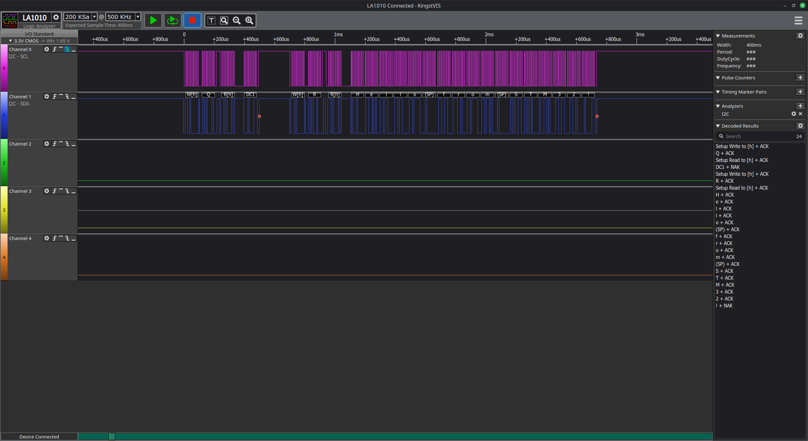
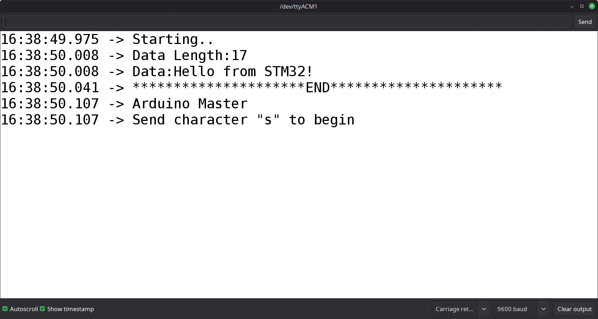
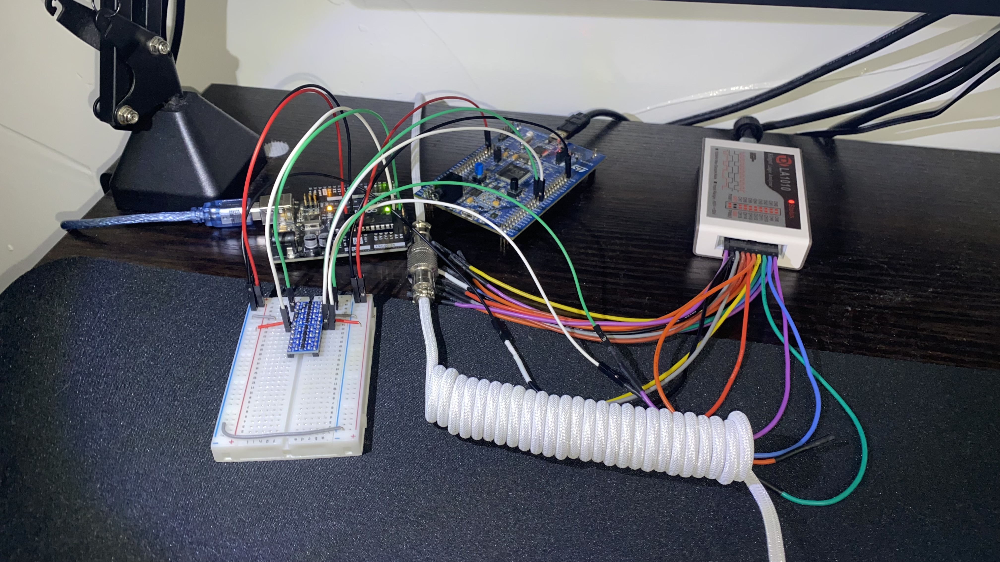

# 012 I2C Slave Transfer Interrupt

### Overview
This demo uses the custom interrupt-driven I2C-slave code for the STM32F407 to send a variable-length message to an Arduino acting as an I2C master.

The main I2C-slave code for the STM32 simply polls a `failure` flag to see if the peripheral must be reset or not. If the flag is asserted, it resets and reinitializes the I2C peripheral, then restarts slave listening. Event responses are handled in the `I2C_ApplicationEventCallback` function.

This callback responds to the `I2C_EVT_SLAVE_ADDR_MATCH`, which lets the application know that a master requested its address. If the master wants to transmit the command code, the slave reads it into the `cmd` variable. If the master wants to receive data, the slave responds with either the message length, or the message itself, depending on the value of the `cmd` variable. 

The `I2C_EVT_RX_DONE`, `I2C_EVT_TX_DONE`, and `I2C_EVT_STOP` events are handled by simply returning out of the callback function. All other events are treated as errors and cause a peripheral reset.

The Arduino master uses the `<Wire.h>` library to send commands and read data using I2C.

## Files
- **STM32 Master File**: `Src/012I2C_SlaveTxInterrupt.c`
- **Arduino Slave File**: `arduino/012_MasterRxString/012_MasterRxString.ino`

## Wiring
The hardware required to replicate this demo includes:
- Arduino Uno Board
- STM32F407G Discovery Board
- Breadboard
- 3.3V/5V Bi-directional, I2C-compatible Level Shifter
- Jumper Wires
- Pull-up Resistors
- Logic Analyzer (*optional*)

1. Connect the level-shifter to 3.3V (*from the STM32 board*) and 5V (*from the Arduino*), and a common ground (*from the Arduino **and** STM32 board*). Note that the **LV** (*low-voltage*) side of the level-shifter should be connected to 3.3V, and the **HV** (*high-voltage*) side should be connected to 5V.
2. `A5 -> PB6`: Connect the **SCL** of the Arduino (Pin A5) to the **SCL** of I2C1 on the STM32 (PB6) through the level shifter.
3. `A4 -> PB7`: Connect the **SDA** of the Arduino (Pin A4) to the **SDA** of I2C1 on the STM32 (PB7) through the level shifter.
4. If the level-shifter does not contain built-in pull-ups, connect external pull-ups to each side of the level-shifter, on both the SCL and SDA lines.
5. (*optional*) Connect the logic analyzer to the breadboard rows to snoop data. Note that this will increase the capacitance of the I2C bus.

## Images

### Logic Analyzer Sample

- *The decoded data can be seen in the bottom-right panel.*

### Arduino Serial Terminal Output

### Hardware Setup

