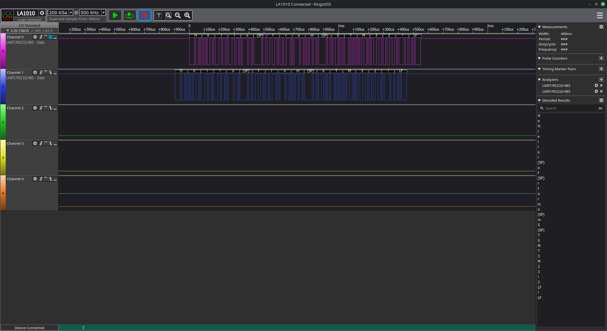
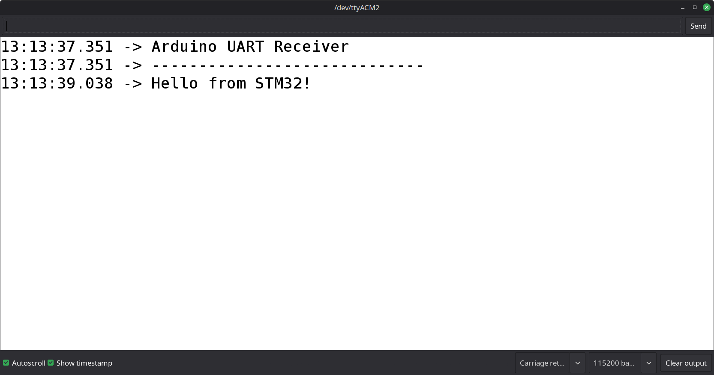
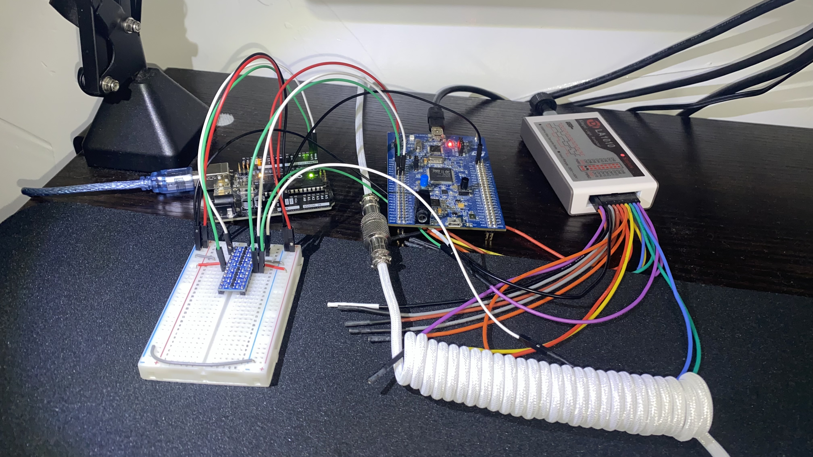

# 013 USART Tx Demo

### Overview
This demo uses the custom USART/UART drivers for the STM32F407 to transmit a message to an Arduino Uno R3 board.

The demo configures USART2 for transmit-only operation and configures PA2 and PA3 for alternate function mode AF7. The onboard user button is configured and triggers transmission of the message `"Hello from STM32!\n"` after the button is released. Baud rate, word-length, parity, stop-bits, oversampling, and hardware flow-control use the defaults provided by USART_ConfigInit().The Arduino receiver must match these settings for successful communication.
 
If USART_SendData() returns an error, the demo resets and
reinitializes the USART2 peripheral. 

A bidirectional level shifter connects the STM32's 3.3V pins to the
Arduino's 5V pins. Both boards and the level shifter must
share a common ground.

## Files
- **STM32 Transmitter File**: `Src/013USART_Tx.c`
- **Arduino Receiver File**: `arduino/013_USART_arduino_Rx/013_USART_arduino_Rx.ino`

## Wiring
The hardware required to replicate this demo includes:
- Arduino Uno Board
- STM32F407G Discovery Board
- Breadboard
- 3.3V/5V Bi-directional Level Shifter
- Jumper Wires
- Pull-up Resistors
- Logic Analyzer (*optional*)

1. Connect the level-shifter to 3.3V (*from the STM32 board*) and 5V (*from the Arduino*), and a common ground (*from the Arduino **and** STM32 board*). Note that the **LV** (*low-voltage*) side of the level-shifter should be connected to 3.3V, and the **HV** (*high-voltage*) side should be connected to 5V.
2. `D0 -> PA2`: Connect the **RX** of the Arduino (Pin D0) to the **TX** of USART2 on the STM32 (PA2) through the level shifter.
3. `D1 -> PA3`: (*optional*) Connect the **TX** of the Arduino (Pin D1) to the **RX** of USART2 on the STM32 (PA3) through the level shifter.
4. If the level-shifter does not contain built-in pull-ups, connect external pull-ups to each side of the level-shifter, on both the TX and RX lines.
5. (*optional*) Connect the logic analyzer to the breadboard rows to snoop data.

## Images

### Logic Analyzer Sample

- *The decoded data can be seen in the bottom-right panel.*

### Arduino Serial Terminal Output

### Hardware Setup

