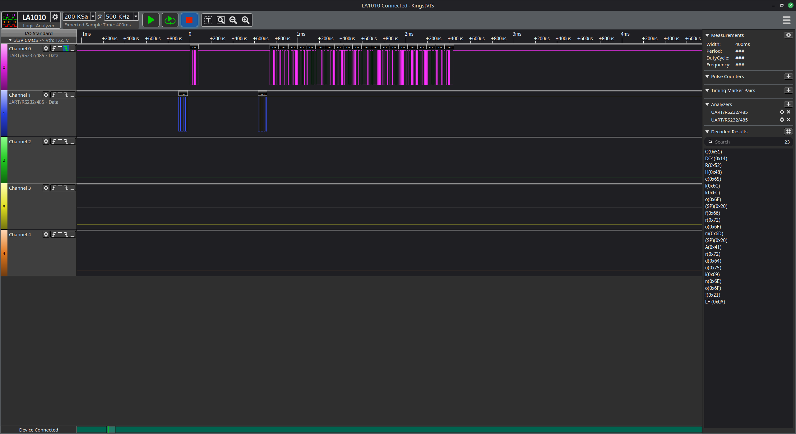
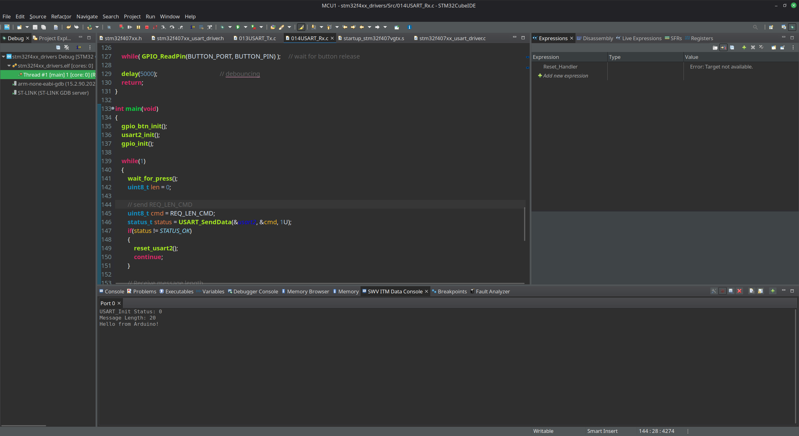
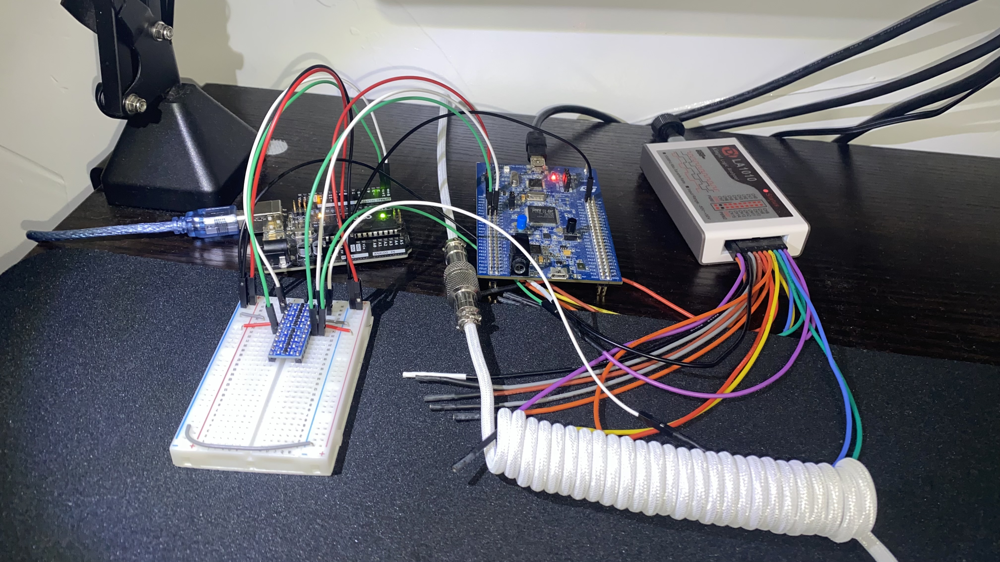

# 014 USART Rx Demo

### Overview
This demo uses the custom USART/UART drivers for the STM32F407 to receive a variable-length message from an Arduino Uno board.

This demo configures USART2 for Tx-Rx operation and configures PA2 and PA3 for alternate function mode AF7. The onboard user button is configured and triggers a sequence of USART transfers:

1. The STM32 sends the `REQ_LEN_CMD` (`0x51`) command code to the Arduino to request the length of the message.
2. The STM32 then reads the length of the message into the `len` variable.
3. The STM32 sends the `SEND_MSG_CMD` (`0x52`) to the Arduino, to request the message itself.
4. Finally, the STM32 reads the message into a buffer, and prints the buffer to the user.

Baud rate, word-length, parity, stop-bits, oversampling, and hardware flow-control use the defaults provided by USART_ConfigInit(). The Arduino peer must match these settings for successful communication.
 
If any USART_SendData()/USART_ReceiveData() returns a non-ok status, the USART2 peripheral is reset, reinitialized, and the current transfer sequence is aborted. A new sequence begins on the next button trigger.

A bidirectional level shifter connects the STM32's 3.3V pins to the
Arduino's 5V pins. Both boards and the level shifter must
share a common ground.

## Files
- **STM32 Transmitter File**: `Src/014USART_Rx.c`
- **Arduino Receiver File**: `arduino/014_USART_Arduino_Tx/014_USART_Arduino_Tx.ino`

## Wiring
The hardware required to replicate this demo includes:
- Arduino Uno Board
- STM32F407G Discovery Board
- Breadboard
- 3.3V/5V Bi-directional Level Shifter
- Jumper Wires
- Pull-up Resistors
- Logic Analyzer (*optional*)

1. Connect the level-shifter to 3.3V (*from the STM32 board*) and 5V (*from the Arduino*), and a common ground (*from the Arduino **and** STM32 board*). Note that the **LV** (*low-voltage*) side of the level-shifter should be connected to 3.3V, and the **HV** (*high-voltage*) side should be connected to 5V.
2. `D0 -> PA2`: Connect the **RX** of the Arduino (Pin D0) to the **TX** of USART2 on the STM32 (PA2) through the level shifter.
3. `D1 -> PA3`: Connect the **TX** of the Arduino (Pin D1) to the **RX** of USART2 on the STM32 (PA3) through the level shifter.
4. If the level-shifter does not contain built-in pull-ups, connect external pull-ups to each side of the level-shifter, on both the TX and RX lines.
5. (*optional*) Connect the logic analyzer to the breadboard rows to snoop data.

## Images

### Logic Analyzer Sample

- *The decoded data can be seen in the bottom-right panel.*

### STM32 Serial Wire Viewer Output

### Hardware Setup

