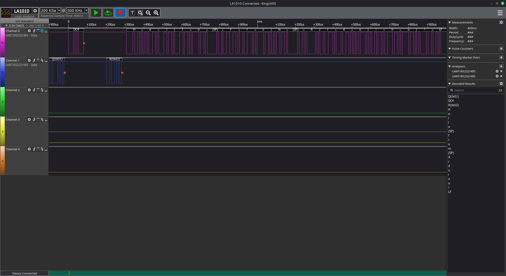
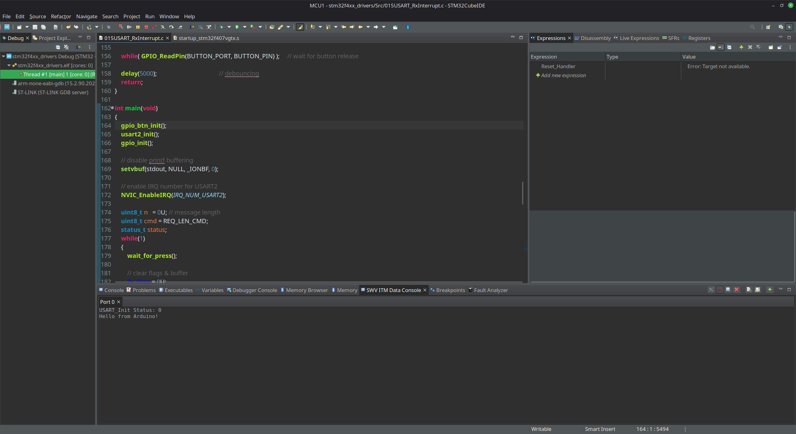
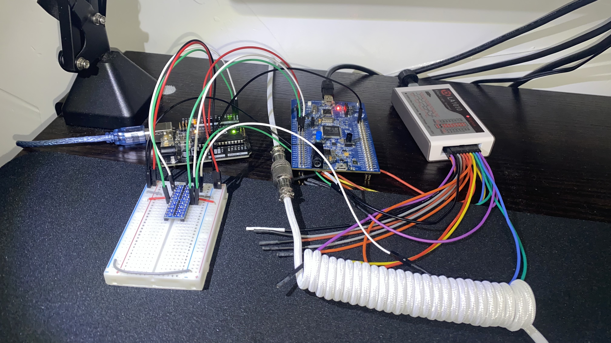

# 015 USART Interrupt-Driven Rx Demo

### Overview
This demo uses the custom interrupt-driven USART/UART drivers for the STM32F407 to receive a variable-length message from an Arduino Uno board.

A button-press starts a command/response exchange using the custom interrupt-driven USART/UART drivers:
1. The STM32 arms reception of a one-byte message length, then sends the `REQ_LEN_CMD` (`0x51`) command code to request the length from the Arduino.

2. The STM32 waits for both command transmission and reception to complete. The received length is stored in `n`.

3. The STM32 arms reception of the specified number of message bytes, then sends the `SEND_MSG_CMD` (`0x52`) command code to request the message itself from the Arduino.

4. The STM32 waits for both command transmission and message reception to complete, appends a null terminator, and prints the message.

Baud rate, word-length, parity, stop-bits, and hardware flow-control use the defaults provided by `USART_ConfigInit()`. The Arduino peer must match these settings for successful communication.

Reception is armed before each command is transmitted so that the STM32 is ready to receive the response from the Arduino immediately. `USART2_IRQHandler()` delegates interrupt processing to `USART_IRQHandling()`. The application callback updates completion and error flags.

Transfers are interrupt driven, but the main code busy-waits for completion. This program simply demonstrates the functionality of the interrupt-driven APIs.

## Files
- **STM32 File**: `Src/015USART_RxInterrupt.c`
- **Arduino File**: `arduino/014_USART_Arduino_Tx/014_USART_Arduino_Tx.ino`

## Wiring
The hardware required to replicate this demo includes:
- Arduino Uno Board
- STM32F407G Discovery Board
- Breadboard
- 3.3V/5V Bi-directional Level Shifter
- Jumper Wires
- Pull-up Resistors
- Logic Analyzer (*optional*)

1. Connect the level-shifter to 3.3V (*from the STM32 board*) and 5V (*from the Arduino*), and a common ground (*from the Arduino **and** STM32 board*). Note that the **LV** (*low-voltage*) side of the level-shifter should be connected to 3.3V, and the **HV** (*high-voltage*) side should be connected to 5V.
2. `D0 <- PA2`: Connect the **RX** of the Arduino (Pin D0) to the **TX** of USART2 on the STM32 (PA2) through the level shifter.
3. `D1 -> PA3`: Connect the **TX** of the Arduino (Pin D1) to the **RX** of USART2 on the STM32 (PA3) through the level shifter.
4. If the level-shifter does not contain built-in pull-ups, connect external pull-ups to each side of the level-shifter, on both the TX and RX lines.
5. (*optional*) Connect the logic analyzer to the breadboard rows to snoop data.

## Images

### Logic Analyzer Sample

- *The decoded data can be seen in the bottom-right panel.*

### STM32 Serial Wire Viewer Output

### Hardware Setup

